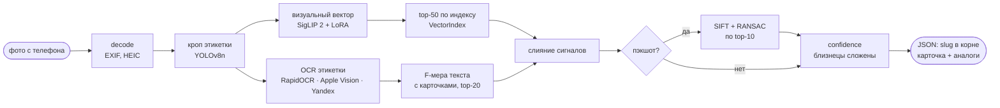
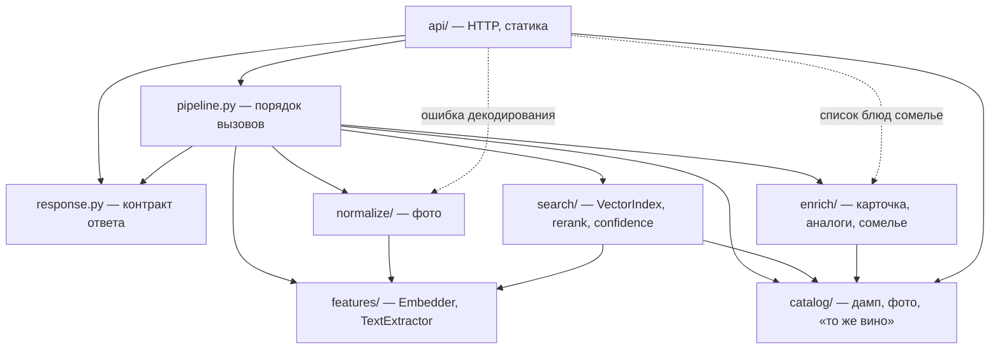

# Архитектура

Визуальная и текстовая ветки идут параллельно: латентность — максимум веток,
а не сумма.

На фото с полки кроп делает YOLOv8n. Если кадр — пэкшот (бутылка целиком на
однотонном фоне, фото с экрана), кроп идёт по фону, и после слияния
включается геометрическая проверка.

## Слои

Стрелки — единственные разрешённые зависимости между слоями (`settings.py`
доступен всем). Модели и драйверы (torch, YOLO, OCR, faiss, psycopg)
импортируют только `features/`, `normalize/` и `search/`. Это проверяет
`tests/test_architecture.py` на каждом пуше.

| Слой | Пакет | Что внутри |
|---|---|---|
| Нормализация | `normalize/` | `image.py` — EXIF-ориентация, HEIC, единое RGB; `label_crop.py` — YOLOv8n-детектор этикетки (центральная бутылка), баланс белого; `query.py` — из одного кадра два вида: для эмбеддера и для OCR |
| Признаки | `features/` | `embedder.py` — протокол `Embedder`, SigLIP 2 и гистограмма; `lora.py` — адаптер для запросов; `text/` — протокол `TextExtractor`: Yandex OCR ↔ RapidOCR (в контуре, любая ОС) ↔ Apple Vision ↔ выключено |
| Поиск | `search/` | `index.py` — протокол `VectorIndex` (numpy ↔ faiss ↔ pgvector), несколько эталонов на позицию; `pgvector_index.py` — тот же протокол поверх PostgreSQL; `rerank/text_match.py` — текстовый скор; `rerank/fusion.py` — слияние; `rerank/geometric.py` — SIFT + RANSAC на пэкшотах, признаки эталонов кэшируются в `artifacts/geometric_sift.npz`; `confidence.py` — вероятности с учётом близнецов и решение «показать карточку сразу» (`decide`); `rerank/vlm_judge.py` — офлайн-эксперимент (`scripts/eval_judge.py`), в `/scan` не участвует |
| Каталог | `catalog/` | `loader.py` — дамп с неизвестными заранее колонками; `photo_match.py` — имя фото в дампе → файл после Strapi; `models.py` — карточка, нечёткое «то же вино» (фото карточки — превью из `scripts/make_thumbnails.py`); `browse.py` — поиск и фильтры каталога для UI |
| Обогащение | `enrich/` | `traits.py` — сорта, сахар, игристость, аромат из карточки; `pairing.py` — к чему подать; `rating.py` — демо-рейтинг; `analogs.py` — аналоги других виноделен по сортам (Jaccard) и профиль снимка для вина вне каталога (`out_of_catalog`); `sommelier.py` — подбор к блюду; `card.py` — сборка карточки |
| Оркестрация | `pipeline.py` | только порядок вызовов; `rank()` используют и сервис, и калибровка |
| Контракт ответа | `response.py` | плоский JSON со `slug` в корне: обычный ответ, `fallback` (фото не прочитано — позиция каталога и `error`), `degraded` (вино найдено, карточка не собралась — slug тот же) |
| HTTP | `api/app.py` | `/scan` (+ алиасы), `/wines` (каталог), `/wines/{slug}`, `/sommelier`, `/health`, статика фронтенда |

Два протокола — точки замены, названные в ТЗ:
- `TextExtractor` — облачный OCR ↔ локальный: если на созвоне пропадёт сеть,
  `FallbackExtractor` переключится на локальный OCR (Apple Vision / RapidOCR) в том же запросе;
- `VectorIndex` — NumPy ↔ faiss ↔ pgvector: перенос на стек заказчика
  (`index.kind` в YAML). `PgVectorIndex` хранит эталоны в таблице с колонкой
  `vector(768)` и HNSW-индексом по косинусу (`<=>`). Источник истины —
  `artifacts/index.npz` (его пишет `scripts/build_index.py`): на старте таблица
  сверяется с ним по хэшу содержимого и при расхождении (пересборка, смена
  модели) перезаливается одной транзакцией — переносу не нужен пересчёт
  эмбеддингов, а поиск не может молча пойти по векторам старой модели.
  Замер на боевом индексе (2099 позиций): перенос 5,5 с, поиск
  ~10 мс, повторный старт 0,05 с; top-1 совпадает с точным NumPy-поиском в
  193–196 из 200 запросов (HNSW — приближённый поиск, граф от сборки к сборке
  разный). По умолчанию остаётся точный NumPy-индекс. Тест `tests/test_pgvector_index.py` сверяет обе
  реализации на живой базе (в CI — сервис `pgvector/pgvector`).

Всё, что подбирается замером, — в `config/config.yaml`; модель в
`pipeline.py` не упоминается.

## Решения и замеры, на которых они основаны

**Каталог важнее модели.** Клиенты загружали разные фото под одинаковыми
именами («Screenshot_9.webp», «Шардоне.webp»), а в папке фото лежат и
картинки блога. У вин «Олег», «Победа», «Буковинка», «Цитрон» (Табия) эталоном
в индексе был баннер ярмарки или застолье — такое вино не находилось никогда.
`prepare_catalog.py` выбирает среди одноимённых файлов тот, что SigLIP
(zero-shot) считает фото бутылки и на котором OCR читает название этого вина,
и печатает все спорные решения в отчёт. Одна эта чистка: 69 % → 81 % top-1.

**Текст различает серию.** Вина одной линейки («Жемчужная 9 Цитрон, Шардоне»
и «… Алиготе, Цитрон») визуально почти одинаковы. Текстовый скор — F-мера
между полнотой (слова карточки на этикетке) и точностью (слова этикетки,
объяснённые карточкой), IDF-веса по каталогу, транслит в одно «рыхлое»
написание (cz/ts/c, й/j/i), вес строки по размеру шрифта, склейка разорванных
OCR слов. Одна полнота выбирала короткие названия («Массандра Мускат» вместо
«Мускатель белый»). Вклад: +5 п.п. top-1, top-5 до 98 %.

**Полевые фото в индекс не добавляются.** Проверено: фото с полки похоже на
другие фото с полки сильнее, чем на студийный эталон, и перетягивает запросы —
точность падала с 84 % до 48–69 %.

**LoRA — только на запросах и только вместе с текстом.** Адаптер сдвигает
фото с телефона к студийным эталонам; каталог кодируется базовой моделью, и
индекс от адаптера не зависит. На фото вне его обучения без текста он хуже
базы, с текстом — наравне; на знакомых винах — заметно лучше.

**Геометрия SIFT — только на пэкшотах.** Пэкшот почти копия эталона каталога,
и число геометрически согласованных совпадений локальных признаков (SIFT,
RANSAC-гомография) разводит соседей по серии надёжнее глобального вектора:
размытие, шум и блик портят вектор целиком, а совпадения — лишь частично.
На скрытой синтетике из 300 искажённых фото каталога: 64,7 % → 92,7 % top-1.
На фото с полки проверка выключена: этикетки одной винодельни делят логотипы
и шрифты, и ложных совпадений столько же, сколько верных (61/63 → 59/63 уже
при малом весе). Поэтому в общем слиянии `fusion.weights.geometric: 0.0`, а
на пэкшоте проверка подставляет свои веса: geometric 1.0, textual 0.1,
top-10 кандидатов (секция `rerank.geometric`, значения по умолчанию — в
`build_verifier`).

**Confidence.** Softmax по слитым скорам, вероятности карточек одного вина
(близнецы, винтажи) складываются. Плюс абсолютная проверка
`visual + 0.5·text ≥ 0.6`: вино вне каталога часто родственник вина из
каталога той же серии, и относительная уверенность его не отличает.
Калибровка на 63 фото из каталога и 37 вне его. Порог влияет только на UI:
карточка сразу или экран «возможно, одно из них» с аналогами.

## Дообучение

Три обученных компонента, у каждого — скрипт, закреплённые данные и сплит в
репозитории. Полевые фото — из архива кейса (`data/field/`), в git не входят;
всё остальное, включая разметку, — в `training/`.

| Что | Скрипт | Данные и сплит | Результат | В сервисе |
|---|---|---|---|---|
| Детектор этикетки YOLOv8n (1 класс) | `scripts/train_label_detector.py` | рамки команды по 100 полевым фото: `training/label_boxes/{train,val}` — 80 / 20 | mAP50 0,965, mAP50-95 0,818 на валидации (исходный прогон, GPU); повтор этим скриптом на CPU — 0,933 / 0,786 | `artifacts/models/label_yolov8n.pt`, кроп запроса |
| LoRA r=8 на attention vision-башни SigLIP 2 | `scripts/train_lora.py` | пары «полевое фото → эталон каталога», InfoNCE против замороженного индекса; `training/lora_train_photos.txt` — 48 фото, валидация — остальные 15 | только по картинке на 15 фото валидации: top-1 73,3 %, top-5 93,3 %; во всём пайплайне с текстом — 15/15 | `artifacts/models/siglip_lora_v2.pt`, только запросы |
| Голова запросов | `scripts/train_query_head.py` | синтетика «бутылка на полке» из эталонов каталога, сплит по винам | синтетика 66,5 % → 79,0 % на винах вне обучения, на полевых фото без эффекта | выключена (`embedder.siglip.query_head`) |

Общие правила:
- **Каталог не дообучается.** Индекс кодируется базовой моделью, адаптеры —
  только на стороне запроса, поэтому новое вино попадает в поиск без
  переобучения: достаточно его эталона.
- **Честная валидация.** Фото, на которых учился адаптер, в метриках
  показываются отдельно (`scripts/eval_offline.py`, строка «вне обучения
  LoRA»); синтетика делится по винам, а не по кадрам.
- **Запрос при обучении нормализуется тем же `QueryNormalizer`,** что и в
  сервисе, — обучение и инференс видят один и тот же кадр.
- `make train-yolo`, `make train-lora` ставят `requirements-train.txt`
  (albumentations) и пишут веса в `artifacts/models/`; `--eval-only` у
  `train_lora.py` оценивает готовый адаптер на той же валидации.

## Стенд оценки

- `scripts/eval_offline.py` — признаки фото кэшируются, перебор конфигураций
  за секунды; отдельно считает фото, которых LoRA не видела;
- `scripts/evaluate.py` — последовательные HTTP-запросы, как у кейсодержателя;
- `scripts/calibrate.py` — температура и порог по тому же `pipeline.rank()`.

## Воспроизводимость

- `requirements.txt` — что ставить, `constraints.txt` — точные версии окружения,
  на котором сняты все замеры (Python 3.12). Docker и CI ставят
  `pip install -r requirements.txt -c constraints.txt`, torch — с CPU-индекса.
- Docker-образ самодостаточен: код, каталог, превью фото, индекс, SIFT эталонов,
  веса YOLO и LoRA — в репозитории, веса SigLIP 2 скачиваются при сборке.
- CI (`.github/workflows/ci.yml`) на каждом пуше: ruff; pytest — контракт ответа
  по схеме `ScanResponse`, границы слоёв (`tests/test_architecture.py`), каталог,
  поиск, обогащение, устойчивость, pgvector на живой базе; сборка образа из
  чистого клона; запрос как у `participant_test.sh` (`slug` в корне и не `null`,
  в том числе на мусоре вместо фото); точность на 60 синтетических фото из
  каталога (`scripts/make_synthetic.py`) с порогом top-1 75 %; тот же сервис с
  индексом в pgvector.
- `Makefile` — одна команда на шаг: `setup`, `test`, `index`, `run`, `docker`,
  `docker-pg`, `eval`, `synth`.

## Перенос на стек заказчика

| Компонент заказчика | Что берётся из решения |
|---|---|
| Strapi (каталог) | `scripts/prepare_catalog.py` — дамп → каталог с сопоставлением фото; колонки дампа — синонимы в `config.yaml`, код не меняется |
| PostgreSQL + pgvector | `docker-compose.pgvector.yml` (или `INDEX_KIND=pgvector`, `PGVECTOR_DSN`) — индекс переносится из npz на первом старте; сквозной прогон 60 синтетических фото даёт ту же точность, что NumPy-индекс, +20 мс |
| Nuxt (фронт портала) | вызывает `POST /scan` по схеме `ScanResponse` из OpenAPI (`/docs`) и рисует ответ; `card.url` ведёт на страницу вина портала, CORS — `CORS_ORIGINS` |
| Модели | сервис Python рядом с порталом: SigLIP 2 + LoRA, YOLOv8n, OCR — за протоколами `Embedder` и `TextExtractor` |
